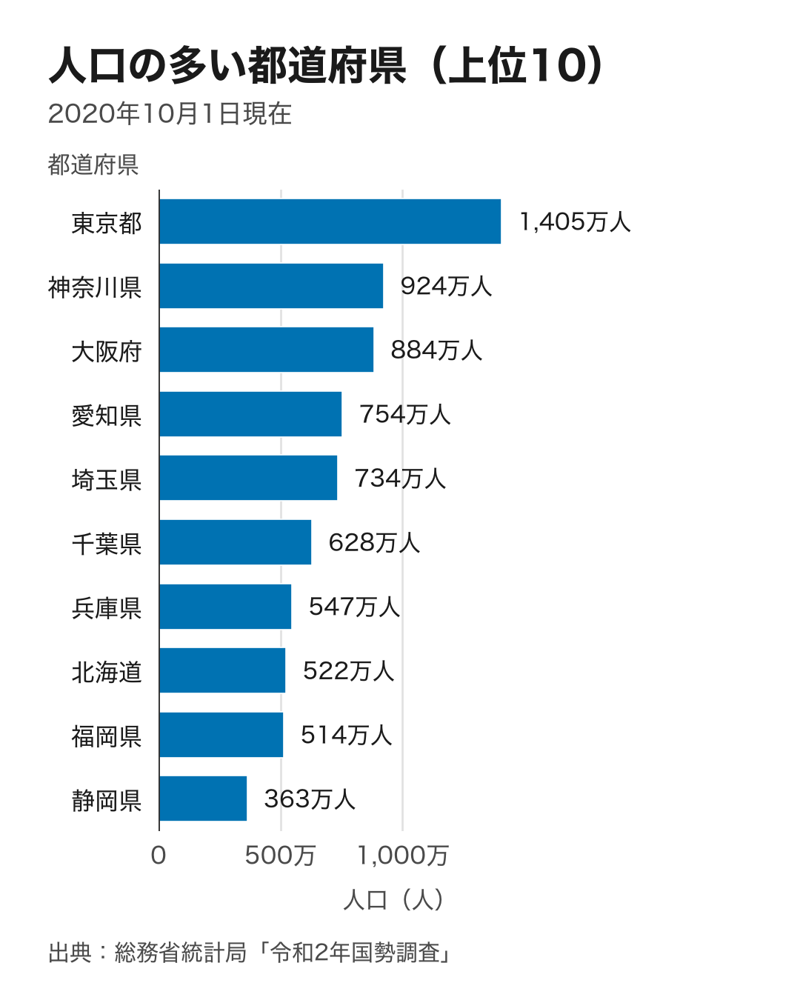
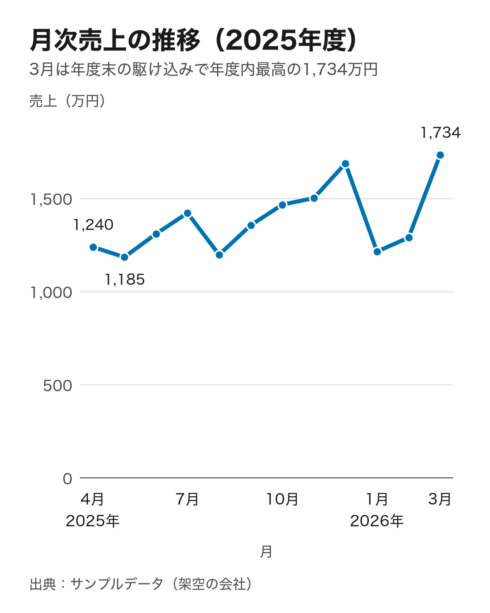
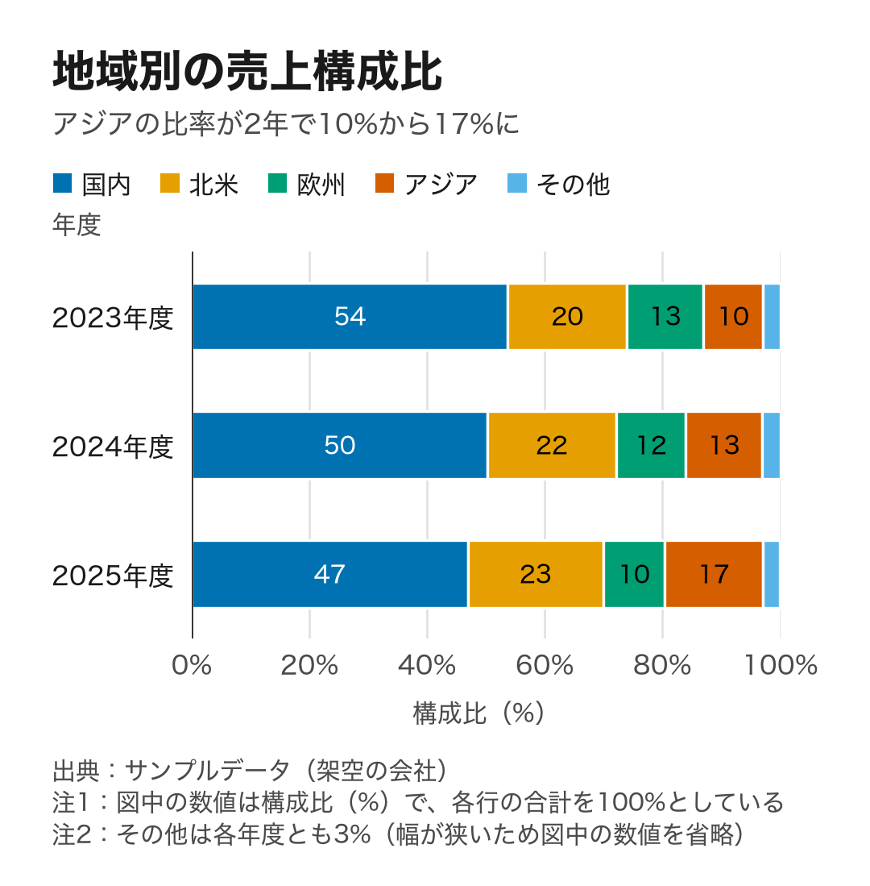

# jp-charts for Hermes Agent

## 何が唯一か

Before `chart_render` runs, `pre_tool_call` blocks the call when a plotted number was already returned, in this session, with a different unit string. The check reads a comma-grouped number the same way the chart parser reads `1,234`, so `45,095,325,000,000` with unit `百万円` is blocked when that integer was returned as `円`. No PNG is written. A chart whose numbers were not returned by another tool is unchanged. The remembered pairs stay in the process for that session. They are not written to profile state. `transform_llm_output` does not replace or delete the model's sentences. It appends one fixed line only when this turn's tool record has no figure and the turn is in scope: a tool from jp-corporate, jp-edinet, jp-address, jp-subsidies, jp-egov-law, or jp-charts was called, or any tool was called on a company or filing question. The line is: "Tool record: this turn returned no company, filing, address, subsidy, statute, or chart figure, so a number or a fetch claim in this reply is not from a tool result." The decision reads the tool record. It does not match a list of success phrases. A settings reply, a `web_search` result, and a phone number copied from the user are left unchanged. `chart_types` and `chart_validate` are not a figure. A turn whose only area tool is `address_split` is left to that plugin. When a figure was returned, including a capital amount the tool returned, the reply is left as it is. `pre_llm_call` adds one paragraph only on a chart question, and adds nothing on other turns, including "hermes の設定はどこで見る？", "Pythonでフィボナッチ数列を計算する関数を書いて。", and "グラタン皿でチーズグラタンを作る手順を教えて。". A chart question is 図, グラフ, チャート, or the word chart, or `chart_render`, `chart_validate`, or `chart_types` called in the previous turn. A company name and a filing word do not add it. The paragraph is: "Call chart_render only with numbers and the unit string copied from a tool result. Do not call tool_describe. The parameters are known. A comma-grouped number such as 1,234 is the same integer as 1234. A different unit blocks the chart. If no number was returned, do not say a chart was drawn and do not write 取得しました." Hermes keeps the first non-empty `transform_llm_output` string.

## Comparison

Facts checked for the cluster note on 2026-10-26. Buffett Code shows 業績・指標 across several periods on its own pages. This tool does not fetch those figures. It draws a chart only when the unit string matches the unit on the numbers a tool already returned. SPEEDA's company page includes charts inside a report this tool does not reproduce.

Charts for [Hermes Agent](https://github.com/NousResearch/hermes-agent) that you can paste into a report or send to a chat, and trust.

Ask Hermes for a chart and you get a PNG built to be read on a phone, with a `MEDIA:` line that Hermes' chat gateways use to attach the file to the reply. Before the image is handed over, the plugin reads every bar, point and printed number back from the finished figure and compares it with the values it parsed from your data.

| Population, top 10 (horizontal bar) | Monthly sales (line) | Sales mix (100% band) |
|---|---|---|
|  |  |  |

The population chart uses the 2020 census figures (Statistics Bureau of Japan). The other two use sample data from a fictional company. All three images are the plugin's real output at the default `mobile` size (1080 px wide; the band chart is shorter because it has only three rows).

## Install

Needs Hermes v0.21.4 or later (`hermes --version`); if yours is older, run `hermes update` first.

1. Install the plugin and its Python dependencies (matplotlib, plus a Japanese font package):

   ```bash
   hermes plugins install TakeshiTGAL/hermes-plugin-charts --yes-deps --enable
   ```

   Once the plugin is listed in the Hermes plugin catalog, `hermes plugins install jp-charts --yes-deps --enable` works too. To try a local copy instead, run `hermes plugins install "file://$PWD" --yes-deps --enable` inside a clone of this repository.

2. Start a new chat. The CLI does not need a gateway restart. If you use Telegram, Slack or another chat app, restart the gateway too:

   ```bash
   hermes gateway restart
   ```

3. Ask for a chart, in a chat or from the terminal:

   ```bash
   hermes chat -Q -q "Make a bar chart of this table. Unit: 万円. Source: our sales system.
   店舗,売上
   新宿,1450
   梅田,1010
   博多,720"
   ```

   In a terminal the reply gives the PNG's path. In a chat app the reply carries the `MEDIA:` line for the gateway to attach.

No API key, no Node.js and no headless browser. Charts are drawn inside Hermes' own Python process with matplotlib.

## What you get

- **Readable on a phone.** The default canvas is 1080×1350 (4:5), and every text on it is set at a font size of at least 30 px (about 11 pt when the image fills a phone screen). A chart with only a few rows is drawn on a shorter canvas instead of leaving empty space. `wide` (1600×900, for slides) and `square` (1080×1080) are one setting away.
- **Ready to attach in chats.** The tool result carries a `MEDIA:/path.png` line. Hermes' gateways turn that line into an attachment; Hermes' own platform notes list Telegram, Slack, Discord, WhatsApp, Signal, Matrix, Mattermost and the desktop app. Not yet tested: whether the photo actually arrives in a real Telegram, Slack or LINE chat. What the tests confirm is that Hermes' `extract_media` (the gateway step that pulls attachments out of a reply) picks up the chart's file from the final reply. If the model forgets to include the line, the plugin's output hook adds it at the end of the turn (not in the terminal, the TUI, ACP, SMS, the API server or webhooks). LINE needs `LINE_PUBLIC_URL` set, because LINE only accepts images from a public HTTPS URL. Chatwork has no built-in Hermes adapter: images only arrive there if the Chatwork platform plugin you use supports file upload.
- **Every chart is labeled.** Value-axis titles always include the unit, and every chart prints its source. `unit` and `source` are required, and an error tells the model what to put there (for numbers the user typed: "Data provided by the user").
- **Japanese that never turns into boxes.** The plugin uses a Japanese system font when one is installed (BIZ UDPGothic, Hiragino Sans, Noto Sans CJK JP, Yu Gothic, Meiryo), and otherwise IPAexGothic, which comes with the `matplotlib-fontja` dependency. A character that no font can draw (an emoji in a title, for example) is reported as an error naming the field. It is never drawn as a box.
- **Japanese number conventions.** Thousands separators everywhere. Large numbers become 万 and 億 (`1,405万`, `3.2億`, or `1.4M` in English), with one scale shared by every label on a chart. Input like `1,234`, `１２３４`, `3.5万`, `1億2000万`, `△120` (negative) and `(2,500)` is read correctly. `-`, `…`, `x` and `***` mean "no value", as they do in e-Stat tables, and the chart says so in a note.
- **Colors that work for color-blind readers.** The Okabe–Ito palette is used throughout. Neighbouring parts are separated by white gaps, lines carry distinct marker shapes, and up to four lines are labeled at their ends, so no one has to match colors to a legend.
- **Honest by default.** Bars always start at zero: a request to cut the axis is refused, with the reason. Line charts start at zero unless you opt out, and then the chart says so. Pie, donut, 3D and dual-axis charts are not offered, and the error points to the alternative. Shares are recomputed from the raw values so each band adds up to exactly 100%. Numbers are rounded half up (12.5 → 13), as Japanese reports expect. Numbers inside a band step down from `53.7%` to `54%` to `54` (one style per chart; a note then says the numbers are percent). A number that still does not fit is printed beside its band with a leader line, and if there is no room at all, a footnote gives the value.
- **Checked before it is returned.** After drawing, the plugin reads the figure back and compares it with the values it parsed from your data: each bar's length, each segment's start, each line point, every data label and every axis tick (parsed back to a number), that each mark sits on its own category label, and that zero is on the axis. The result includes this check together with a table of parsed and drawn values. If any check fails, no image is returned. Titles, footnotes and captions are not checked, and a wrong `unit` is not something the check can see, so read the result's `chart` summary when the unit matters.
- **Your data as it is.** Pass a list of rows, CSV, TSV copied from Excel, a Markdown table, JSON, or the path of a local `.csv`, `.tsv`, `.txt` or `.json` file (UTF-8 or Shift_JIS). Title and footnote lines around a table are skipped. A result in the shape `{columns, rows, unit, source}` (what an e-Stat plugin's `estat_get_data` returns) can be passed as `data` unchanged, and its unit and source are used.
- **Errors that say what to do next.** Every error has a `code`, a `where` (for example `data row 4 (data.values[3]), column '人口': '七百万' is not a number`) and a `fix`.

## Tools

| Tool | What it does |
|---|---|
| `chart_render` | Draws the chart, checks it, saves the PNG to Hermes' image cache and returns `path`, `media`, `alt_text` (use it as the caption) and `verification`. |
| `chart_validate` | The same arguments, without drawing. It shows how the table was read (categories, series, unit, sort) or what is wrong. |
| `chart_types` | When to use each chart type, the encodings each one needs, accepted data formats, presets and limits. |

A request looks like this:

```json
{
  "data": {"text": "月,売上\n2025-04,1240\n2025-05,1185\n2025-06,1310"},
  "chart_spec": {
    "chart_type": "line",
    "title": "月次売上の推移",
    "unit": "万円",
    "source": "社内販売管理システム",
    "encodings": {"x": {"field": "月"}, "y": {"field": "売上"}}
  },
  "output": {"preset": "mobile"}
}
```

Chart types: `bar` (sorted largest first; grouped when there are several y columns; horizontal when labels are long), `line` (dates sorted oldest to newest; gaps for missing periods), `stacked_bar`, and `share_bar` (100% bands, used instead of a pie chart). `x` is always the category or date column, and `y` the numbers, for horizontal bars too. The plugin swaps them back if a model mixes them up. Limits: 8 series, 40 bars, 30 stacks, 15 bands, 500 line points. Each limit comes with an error that suggests `top_n` or an "Other" group.

## Settings

Set these under `plugins.entries.jp-charts.settings` in `config.yaml`, or in the desktop app's plugin settings.

| Key | Default | Meaning |
|---|---|---|
| `preset` | `mobile` | `mobile` 1080×1350, `square` 1080×1080, `wide` 1600×900 |
| `locale` | `auto` | Language of the source line, notes and number units (`ja`, `en`). `auto` follows the data. |
| `font_path` | empty | A `.ttf`, `.otf` or `.ttc` file to try first |
| `auto_attach` | `true` | Add the chart's `MEDIA:` line to a chat reply when the model forgot it |

## What this plugin does on your machine

- **No network access at run time.** It sends no telemetry and stores no credentials. The only downloads happen at install time, when Hermes installs matplotlib and matplotlib-fontja from PyPI.
- **Reads files** only when the model passes `data.path`: any absolute path the Hermes process can read, limited to `.csv`, `.tsv`, `.txt` or `.json` files up to 10 MB. Hidden files and folders (names starting with `.`) and everything under the Hermes home folder are refused. Parts of a file it reads come back to the model (in `chart_validate`'s preview and in error messages), like any tool output.
- **Writes** PNGs to Hermes' image cache (`<HERMES_HOME>/cache/images`, or `<HERMES_HOME>/image_cache` on an older install that still uses it). Run outside Hermes, it writes to `hermes-charts` in the system temp folder. matplotlib keeps its own font cache in its config directory. Removing the plugin deletes its folder only: the PNGs it wrote and the matplotlib and matplotlib-fontja packages stay.
- **Four hooks.** `transform_tool_result` remembers value and unit pairs for this session and returns nothing, so the tool result is unchanged. `pre_tool_call` blocks `chart_render` when a plotted number was already returned in this session with a different unit string, and no PNG is written. `pre_llm_call` adds one context paragraph only on a chart question: 図, グラフ, チャート, or the word chart, or `chart_render`, `chart_validate`, or `chart_types` called in the previous turn. A company name, a filing word, フィボナッチ数列, and グラタン皿 do not add it. On any other turn, including "hermes の設定はどこで見る？", it adds nothing. The paragraph is: "Call chart_render only with numbers and the unit string copied from a tool result. Do not call tool_describe. The parameters are known. A comma-grouped number such as 1,234 is the same integer as 1234. A different unit blocks the chart. If no number was returned, do not say a chart was drawn and do not write 取得しました." `transform_llm_output` does not replace or delete the model's sentences. It appends one fixed line only when this turn's tool record has no figure and the turn is in scope: a tool from those six books was called, or any tool was called on a company or filing question. The line is: "Tool record: this turn returned no company, filing, address, subsidy, statute, or chart figure, so a number or a fetch claim in this reply is not from a tool result." A settings reply, a `web_search` result, and a phone number copied from the user are left unchanged, whatever words they use. `chart_types` and `chart_validate` are not a figure. A turn whose only area tool is `address_split` is left to that plugin. When a figure was returned, including a capital amount the tool returned, the reply is left as it is, including a Japanese paragraph that repeats that amount. On a platform that attaches files, the same hook can also append a `MEDIA:` line for a chart rendered in that session that the reply does not mention. A MEDIA line is appended only when `auto_attach` is on, and not when the reply already names one of the charts. Hermes keeps the first non-empty `transform_llm_output` string.
- **Who can call it.** The `charts` toolset is on for every surface by default, including messaging gateways, and asks for no approval: anyone a gateway lets talk to the bot can make it draw charts, and the agent can call the tools on its own. Turn the toolset off per surface with `hermes tools`.
- **Skill.** The plugin also registers one skill, `chart-png`, which tells the agent to look these tools up with tool_search. On a surface where `hermes tools` turned the tools off, the calls are unavailable. Disabling the plugin removes the skill.
- **No shell commands and no background processes.** It does not change matplotlib's `rcParams`, so other tools in the same process draw as before. It does add IPAexGothic (and your `font_path`, if set) to matplotlib's shared font list, and while a chart is being drawn it briefly listens to matplotlib's warnings to catch missing glyphs.

## How it compares

This plugin's request format (data, plus `chart_spec` with `encodings` that map x/y/color to columns) and its render/validate/list split follow [microsoft/flint-chart](https://github.com/microsoft/flint-chart) (MIT). See [NOTICE](NOTICE). [lieflat-charts](https://github.com/larashero3-dotcom/lieflat-charts) was read for comparison only. Its license (PolyForm Noncommercial 1.0.0) does not allow reuse in an MIT plugin, and nothing was taken from it.

The table describes flint-chart at commit [`683d5de`](https://github.com/microsoft/flint-chart/tree/683d5de1ffd0c1a76001ca5aa044f297276d7734) and lieflat-charts at commit [`eace082`](https://github.com/larashero3-dotcom/lieflat-charts/tree/eace082a317b696c5570c25826a53a7fa113e984), as read on 2026-10-02. Both projects move quickly; check their current READMEs.

| | flint-chart | lieflat-charts | jp-charts |
|---|---|---|---|
| What it is | Chart spec compiler (JS library) + MCP server | Agent skill (`SKILL.md`) + HTML templates | Hermes plugin (3 tools + 4 hooks) |
| Output | Interactive MCP App view by default; PNG/SVG as MCP image content; backend specs (Vega-Lite, ECharts, Chart.js, Plotly, Excel) | HTML charts and full-page HTML reports | PNG file plus a `MEDIA:` line for Hermes' chat gateways to attach |
| Runtime | Node.js (`npx flint-chart-mcp`) | The agent writes HTML | Python inside Hermes (matplotlib); no browser, no Node |
| Chart variety | Large (dozens of templates, 10 visual themes) | Large (its `catalog.md` lists 63 chart types; 12 report layouts) | Small on purpose: bar, line, stacked, 100% band |
| Phone-first defaults | Default canvas 400×320 (`baseSize`, per its agent skill) | Designed for pages | 1080×1350, every font size at least 30 px |
| Japanese text | Bundles Liberation Sans + DejaVu Sans (`packages/flint-mcp/src/render/fonts.ts`, no Japanese glyphs) and also loads system fonts | Templates and docs in Chinese and English; Japanese shows if the viewer's browser has a Japanese font | Japanese system font, or IPAexGothic from the matplotlib-fontja dependency; missing glyphs are an error |
| 万/億 and Japanese number input | No formatter for them in the source | No formatter for them in the templates | Read and written (`3.5万`, `△120`, `1,405万`) |
| Unit and source on the chart | Optional `unit` per field (shown beside values or in the axis title); title and subtitle; no source field | Treats sources as part of the design | Both required and always printed |
| Checks the drawn values | `validate_chart` checks the spec before compiling | Contrast and hierarchy checks described in the skill's rules | Reads back every bar, point, label and tick and compares them with the parsed values; refuses to return a mismatch |
| Data in | `data.values`, local JSON/CSV/TSV via `data.url` | Whatever the agent loads | Rows, CSV, Excel TSV, Markdown tables, JSON, local files (UTF-8 or Shift_JIS), e-Stat results |
| License | MIT | PolyForm Noncommercial 1.0.0 | MIT |

flint-chart and lieflat-charts offer far more chart types and visual styles. This plugin covers fewer cases: the charts people put in business reports and chat threads, drawn so they can be pasted as they are, and checked against the parsed numbers before they are returned.

## Development

```bash
python -m venv .venv && . .venv/bin/activate
pip install -r requirements-dev.txt
pytest -q
python scripts/render_examples.py   # after any visual change: refreshes the README images
hermes plugins validate . --install-deps
```

Tested with hermes-agent at commit `0a374d1` (2026-10-02; latest release tag at that point: `v2026.9.24`).

---

## 日本語

Hermes Agent に「このデータをグラフにして」と頼むと、スマホでそのまま読める PNG が返ってきます。返事には `MEDIA:` の行が付き、Hermes のチャット接続はこの行を見て画像を添付します。画像を渡す前に、描き上がった図から棒の長さ・点・数値ラベル・目盛を読み戻し、データから読み取った値と1つずつ突き合わせます。一致しないときは画像を返しません（題名や単位の書き間違いまでは確かめられないので、単位は結果の `chart` 欄で確かめてください）。

### 導入（3手）

Hermes v0.21.4 以上が必要です（`hermes --version` で確認）。古ければ先に `hermes update` を実行してください。

1. `hermes plugins install TakeshiTGAL/hermes-plugin-charts --yes-deps --enable`（プラグインカタログに載った後は `hermes plugins install jp-charts --yes-deps --enable` でも入ります。手元のコピーで試すときは、clone したフォルダで `hermes plugins install "file://$PWD" --yes-deps --enable`）
2. 新しいチャットを始める。CLI に `hermes gateway restart` は要りません。チャットアプリで使う場合は `hermes gateway restart`
3. 頼む。端末からなら `hermes chat -Q -q "この表を棒グラフにして。単位は万円、出典は販売管理システム。（表を貼る）"`

API キー、Node.js、ヘッドレスブラウザはどれも要りません。

### 報告資料で困らないための既定

- **軸と単位**: 値の軸の題には必ず単位を付けます（例: 人口（人））。単位がないと描きません。
- **出典**: 必ず図の下に入れます。ユーザーが打ち込んだ数字なら「ユーザー提供データ」と入ります。
- **数字の書き方**: 桁区切りを入れ、大きな数は万・億で書きます（1,405万、3.2億）。図の中のラベルは同じ桁数にそろえます。入力の「3.5万」「1億2000万」「△120」「１２３４」もそのまま読めます。
- **e-Stat の記号**: 「-」「…」「x」「***」は値なしとして扱い、図の注にもそう書きます。
- **色**: 色覚の多様性に配慮した Okabe–Ito の配色です。区切り線と形の違う印を使い、折れ線は線の端に系列名を書くので、色だけに頼りません。
- **誤解を招く形を避ける**: 棒グラフは必ず0から描きます。円グラフの代わりに帯グラフ（各行の合計が100%）を使います。端数は四捨五入です。帯の中の数値は、入らなければ「53.7%」→「54%」→「54」と図全体で同じ書き方のまま短くします（％を外したときは注にそう書きます）。それでも入らない数値は引き出し線を付けて帯の外に書き、それも無理なら注に値を書きます（例：「その他は各年度とも3%（幅が狭いため図中の数値を省略）」）。
- **文字化けしない**: 日本語のシステムフォントがあればそれを、なければ依存パッケージ matplotlib-fontja に入っている IPAex ゴシックを使います。どのフォントにもない文字（絵文字など）は四角で描かず、どの欄にあるかをエラーで返します。

### 資料に貼るときのコツ

- **スライド用**: 「横長で」と頼むと 1600×900（16:9）で描きます。正方形なら「正方形で」。
- **ファイルの場所**: PNG は `<HERMES_HOME>/cache/images`（通常は `~/.hermes/cache/images`）に保存され、結果の `path` にフルパスが入ります。
- **折れ線の縦軸**: 既定は0から始めます。小さな変化を読み取りたいときは「縦軸を0から始めないで」と頼めます。そのときは図の注に「縦軸は0から始まっていない」と自動で入ります。棒グラフは0から始めないと差を誇張するので、頼まれても0から描きます。

### 対応しているデータ

- 行のリスト
- CSV、Excel からコピーした表（タブ区切り）、Markdown の表、JSON
- ローカルの .csv / .tsv / .txt / .json（Shift_JIS 可。隠しファイルと Hermes のホームフォルダの中は読みません）
- e-Stat プラグインの結果（そのまま渡せます）

表の上の題名の行や、下の「注1)」の行は飛ばして読みます。

### エラーの例

```text
type_mismatch: data row 4 (data.values[3]), column '人口': '七百万' is not a number
fix: Fix or remove those cells. Thousands separators, full-width digits, 万/億 and △ for negatives are fine; leave a cell empty (or '-') when there is no value.
```

### 送り先ごとの注意

- **実機での確認はまだです**: 本物の Telegram・Slack・LINE に写真が届くかは確かめていません。確かめたのは、Hermes の `extract_media`（返事から添付ファイルを拾う処理）がグラフのファイルを拾うところまでです。
- **Telegram・Slack・Discord・デスクトップアプリ**: Hermes の説明では、`MEDIA:` の行の画像は写真として送られます。
- **LINE**: `LINE_PUBLIC_URL`（外から見える HTTPS の URL）の設定が必要です。Hermes の LINE 接続は、公開 URL の画像しか送れないためです。
- **Chatwork**: Hermes に標準の接続がありません。使っている Chatwork 用プラットフォームプラグインがファイル送信に対応していれば届きます。

### 誰が呼べるか・止め方・残るもの

- `charts` の道具は既定でゲートウェイを含む全部の面で有効で、承認を求めません。ゲートウェイでボットと話せる人は誰でもグラフを描かせられ、エージェントも自分で呼べます。面ごとに止めるには `hermes tools`。
- プラグインは skill `chart-png` を1つ登録します（tool_search でこの道具を探すよう促すもの）。プラグインが有効な間、この skill は全部のセッションの skill 一覧に1行入ります。`hermes tools` で道具を切った面でも入り、その面では道具を呼べないだけです。この行を消すにはプラグインを無効にします。
- プラグインを削除して消えるのはプラグインのフォルダだけです。書いた PNG と、入れた matplotlib・matplotlib-fontja は残ります。

## License

MIT. See [LICENSE](LICENSE). Credits and third-party notices are in [NOTICE](NOTICE).
